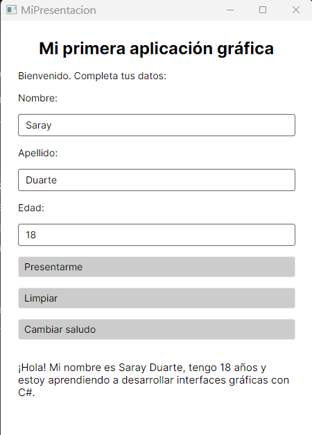
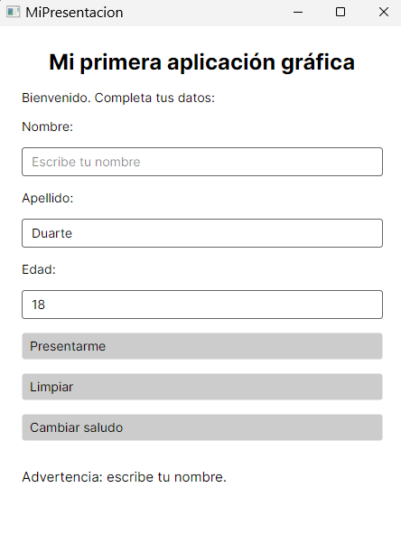
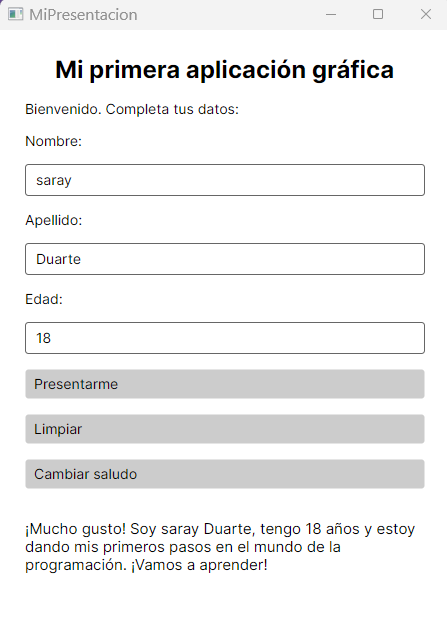
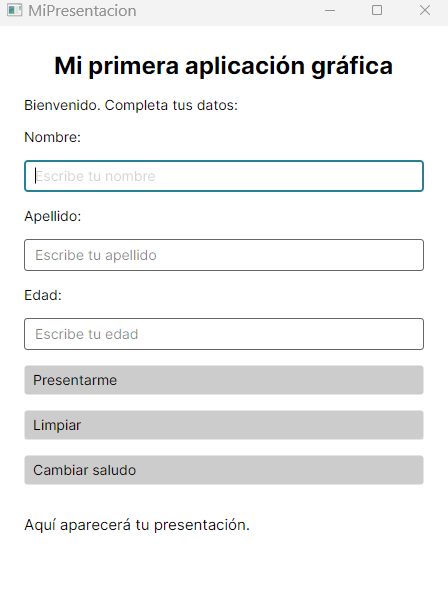

# *MiPresentacion*

> *Mi primera aplicación gráfica con C# y Avalonia UI 11*  
> Aplicación de escritorio desarrollada como proyecto académico para poner en práctica los conceptos de Programación Orientada a Objetos (POO), interfaces gráficas y programación orientada a eventos.

---

## *Descripción del proyecto*

*MiPresentacion* es una aplicación gráfica que permite al usuario ingresar su nombre, apellido y edad para generar una presentación personalizada.

La aplicación cuenta con una interfaz sencilla e intuitiva, validación de datos en tiempo real y botones para interactuar fluidamente con el programa.

---

## *🛠️ Tecnologías utilizadas*

| Tecnología | Descripción |
| :--- | :--- |
| *C#* | Lenguaje de programación principal. |
| *.NET 8* | Plataforma de desarrollo y ejecución. |
| *Avalonia UI 11* | Framework multiplataforma para crear interfaces gráficas. |
| *XAML* | Lenguaje de marcado para el diseño de la interfaz de usuario. |
| *Visual Studio Code* | Entorno de desarrollo integrado (IDE/Editor). |

---

## *Funcionalidades principales*

* *Ingresar datos:* Permite capturar nombre, apellido y edad mediante campos de texto.
* *Presentarme:* Procesa los datos y genera un saludo personalizado en pantalla.
* *Validar información:* Comprueba que ningún campo quede vacío y asegura que la edad sea un número entero mayor que cero.
* *Limpiar:* Restablece todos los campos de entrada y regresa al mensaje inicial.
* *Cambiar saludo:* Alterna dinámicamente entre dos formatos de presentación.

---

## *Interfaz gráfica*

La estructura visual fue construida empleando los siguientes controles nativos de Avalonia UI:

| Control | Función dentro de la aplicación |
| :--- | :--- |
| Window | Ventana principal contenedora de la aplicación. |
| StackPanel | Contenedor de diseño que organiza los elementos de forma vertical. |
| TextBlock | Componente para mostrar títulos, etiquetas fijas y mensajes generados. |
| TextBox | Campos de entrada editables por el usuario. |
| Button | Controles accionables para disparar los eventos de la aplicación. |

Para lograr un diseño limpio y equilibrado se configuraron propiedades clave como Margin, Spacing, FontSize y x:Name.

---

## *Programación orientada a eventos*

La interacción se gestiona mediante eventos Click, los cuales ejecutan métodos específicos en el backend:

| Evento / Manejador | Descripción de la acción |
| :--- | :--- |
| Presentarme_Click | Ejecuta las validaciones y construye la cadena de texto de la presentación. |
| Limpiar_Click | Vacía las cajas de texto y restaura el estado inicial de la interfaz. |
| CambiarSaludo_Click | Alterna entre las dos variantes de saludo preconfiguradas. |

### *Validaciones implementadas*
* string.IsNullOrWhiteSpace(): Evita procesar entradas vacías o compuestas únicamente por espacios.
* int.TryParse(): Garantiza que el valor ingresado en el campo de edad sea estrictamente numérico.
* *Condicional lógico (edad > 0):* Asegura que la edad ingresada corresponda a un número entero positivo válido.

---

## *Relación entre XAML y C#*

* *MainWindow.axaml (Vista):* Define la estructura visual jerárquica de la aplicación, incluyendo disposición de controles, márgenes y estilo visuales.
  * *MainWindow.axaml.cs (Lógica subyacente):* Contiene el código de soporte (code-behind) que implementa el comportamiento, la lógica condicional y las validaciones.

Ambas capas se vinculan a través de:
1. El atributo *x:Name*, que expone los controles del archivo XAML como variables accesibles desde C#.
2. El atributo *Click*, que enlaza directamente los botones con sus respectivos métodos manejadores de eventos.

---

## *Evidencias del funcionamiento*

### *1. Presentación personalizada*
Muestra los datos ingresados y el mensaje generado correctamente por la aplicación.



---

### *2. Validación de datos*
Muestra la advertencia y el bloqueo de flujo cuando se omite algún campo o se ingresan datos inválidos.



---

### *3. Cambio de saludo*
Muestra el mensaje alternativo generado al presionar el botón correspondiente.



---

### *4. Limpiar campos*
Muestra el restablecimiento completo de la interfaz tras accionar el botón de limpieza.



---

## *Instrucciones para ejecutar el proyecto*

### *Requisitos previos*
* [.NET 8 SDK](https://dotnet.microsoft.com/download/dotnet/8.0) instalado.
* [Git](https://git-scm.com/) instalado en el sistema (opcional para clonación remota).

### *Pasos de ejecución*

1. *Clonar el repositorio:*
   ```bash
   git clone [https://github.com/saryduarte/MiPresentacion.git](https://github.com/saryduarte/MiPresentacion.git)
